# 게임 루트 시나리오

> 한 판(15세 → 70세)을 진행하며 갈라지는 모든 경로를 한 곳에 모은 문서다. 규칙의 출처는 코드와 설정값이다:
> 진행 조율 `backend/.../progress/internal/DefaultProgressService.java`, 이벤트 예약 `backend/.../event/internal/DefaultEventService.java`,
> 주거 `backend/.../progress/internal/HousingFlow.java`, 판정 `backend/.../behavior/internal/DefaultBehaviorService.java`,
> 수치 `backend/src/main/resources/application.yml`, 콘텐츠 `content/*.json`. 숫자가 바뀌면 이 문서보다 설정값이 맞다.
>
> 경로는 서로 독립인 여러 **축**(직업 · 투자 · 가족 · 주거 · 경기 · 엔딩)이 시간 위에서 겹쳐 만들어진다. 축의 조합은 사실상 무한하므로,
> 1~2절에서 전체 흐름을, 3~11절에서 축마다 **모든 분기**를, 12절에서 축을 엮은 **대표 루트**를 정리한다.

## 목차

1. [한 판의 큰 흐름](#1-한-판의-큰-흐름)
2. [단계(Phase)와 이벤트 예약 규칙](#2-단계phase와-이벤트-예약-규칙)
3. [성장기 — 성향 장면 10개와 투자자 유형](#3-성장기--성향-장면-10개와-투자자-유형)
4. [직업 축 — 첫 직장, 기다림, 전업투자자](#4-직업-축--첫-직장-기다림-전업투자자)
5. [직장 장면 축 — 연봉·승진·이직·구조조정·번아웃](#5-직장-장면-축--연봉승진이직구조조정번아웃)
6. [투자 축 — 투자 시작, 뉴스, 흔들림, 빚투, 자유 매매](#6-투자-축--투자-시작-뉴스-흔들림-빚투-자유-매매)
7. [가족 축 — 결혼·자녀](#7-가족-축--결혼자녀)
8. [주거 축 — 독립·전월세·전세사기·청약·내 집·갭투자](#8-주거-축--독립전월세전세사기청약내-집갭투자)
9. [생활 축 — 성인 일상 장면과 알림](#9-생활-축--성인-일상-장면과-알림)
10. [경기 축 — 전조·조정·불황·대공황](#10-경기-축--전조조정불황대공황)
11. [매달 정산과 엔딩 — 정상 종료·파산](#11-매달-정산과-엔딩--정상-종료파산)
12. [대표 루트 시나리오](#12-대표-루트-시나리오)
13. [루트 조합표](#13-루트-조합표)

---

## 1. 한 판의 큰 흐름

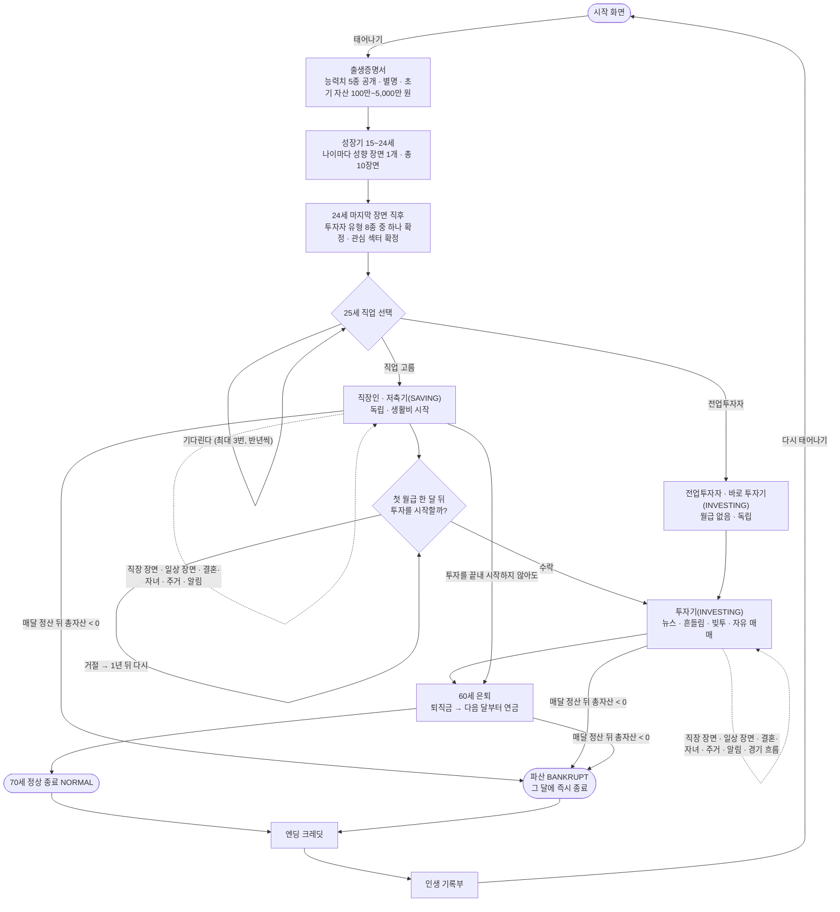

### 나이별 이정표

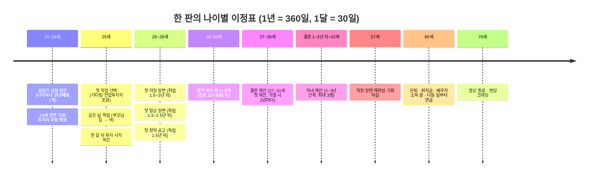

---

## 2. 단계(Phase)와 이벤트 예약 규칙

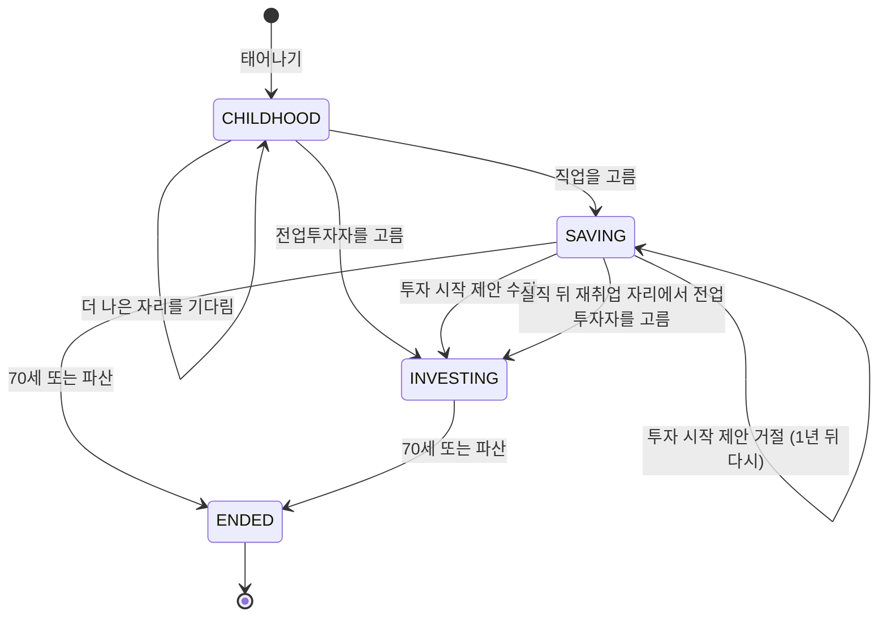

| 단계 | 나오는 이벤트 | 할 수 있는 일 |
|---|---|---|
| `CHILDHOOD` | 성향 장면(TRAIT) 10개 → 직업 선택(JOB) | 선택만 |
| `SAVING` | 투자 시작 제안(OFFER) + 성인 공통 이벤트 | 집 매물 내놓기·거두기 |
| `INVESTING` | 뉴스(NEWS) · 흔들림(SHAKE) · 빚투(LEVERAGE) + 성인 공통 이벤트 | 자유 매매(매수·매도), 집 매물 |
| 성인 공통 (`careerStartDay` 이후) | 일상 장면(TRAIT/adult) · 결혼·자녀(LIFE) · 알림(NOTICE) · 직장 장면(CAREER)/재취업(JOB) · 주거(HOUSING) | |

**예약 규칙** (`DefaultEventService.nextCandidate`)

- 대기 중인 선택이 있으면 다음 이벤트를 만들지 않는다. 판은 그 이벤트 날에서 멈추고, 선택해야 시간이 다시 흐른다.
- 종류마다 "마지막 발생 + 간격"으로 후보 날짜를 만들고, 가장 이른 것 하나만 만든다. 같은 날이면 아래 우선순위가 먼저다.
  `JOB > OFFER > TRAIT > LIFE > CAREER > NEWS > SHAKE > LEVERAGE > HOUSING > NOTICE`
- 간격·장면·숨은 값은 판 시드에서 키별로 뽑는다. 같은 판을 다시 불러도 같은 이벤트가 같은 날에 나온다.
- 알림(NOTICE)은 선택지가 없어 만들어지는 순간 해결된다(판이 멈추지 않는다).

| 이벤트 | 첫 시점 | 다음 간격 | 끝나는 조건 |
|---|---|---|---|
| 성향 장면(성장기) | 15세 반년째 | 나이마다 | 10장면 |
| 직업 선택 | 25세 | 기다림 180일 / 실직 150일 | 직업 결정, 57세 초과, 전업투자자 |
| 투자 시작 제안 | 첫 월급(취업 30일 뒤) | 360일 | 수락 |
| 뉴스 | 투자 시작 + 330~420일 (단기형 300~390일) | 같음 | 70세 |
| 흔들림 | 투자 시작 + 300~600일 | 300~600일 | 보유 종목이 없으면 안 나옴 |
| 빚투 | 보유 종목이 12달 고점 대비 30%↓일 때 즉시 | 최소 720일 | |
| 직장 장면 | 취업 + 540~1,080일 | 540~1,080일 | 57세 초과, 실직, 은퇴, 전업투자자 |
| 일상 장면(성인) | 독립 + 540~900일 | 540~900일 | 8개 풀 소진 |
| 결혼 | 27~31세 중 하나 | 거절 시 2년 | 35세 초과 |
| 자녀 | 결혼 + 1~2년 | 2~3년 | 3명 또는 42세 초과 |
| 알림 | 독립 + 240~600일 | 240~600일 | 70세 |
| 주거 | 독립 당일 | 만기 2년 · 청약 540일 · 집 사기 720일 | 아래 8절 |

---

## 3. 성장기 — 성향 장면 10개와 투자자 유형

나이(15~24세)마다 그 나이의 장면 중 하나를 판 시드로 뽑는다. 선택은 판정으로 뒤집히지 않고, 네 축(기간·위험·소신·관심 섹터)에 점수를 쌓으며 능력치를 조금(최대 ±8) 움직인다. 몇몇 선택지는 돈을 주거나 쓴다.

| 나이 | 후보 장면 (판마다 1개) |
|---|---|
| 15 | 동아리 선택 · 아빠의 주식 5만 원 · 친구들 패딩 |
| 16 | 온라인 할인 10분 · 주말 알바 제안 |
| 17 | 모의고사와 학원 · 느려진 폰 |
| 18 | 첫 알바 월급 · 수능 끝 여행 · 친척의 비상장 주식 |
| 19 | 전공 선택 · 등록금 400만 원 |
| 20 | 동기들의 코인 · 선배의 창업 팀 |
| 21 | 인턴 두 곳 · 룸메이트의 "코인 바닥" · 휴학하며 모은 300만 원 |
| 22 | 투자 동아리 창립 멤버 · 세계여행 400만 원 |
| 23 | 중고차 할부 · 정규직 전환 면담 |
| 24 | 투자 모임 · 첫 자취 월세 vs 전세 · 부모님 종잣돈 500만 원 |

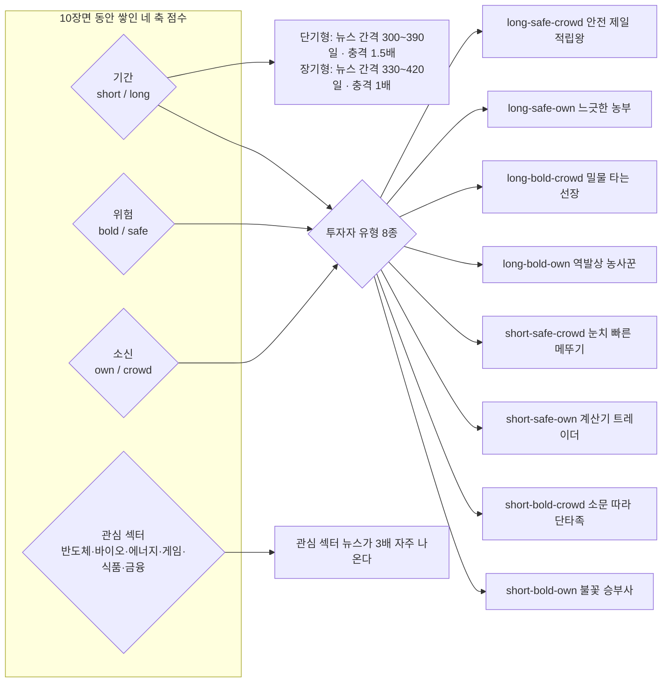

이 성향은 이후 바뀌지 않는다. 성인 일상 장면은 능력치만 움직인다(9절).

---

## 4. 직업 축 — 첫 직장, 기다림, 전업투자자

직업 선택지는 가중치로 뽑은 직업 3개 + (조건부) "더 나은 자리를 기다린다" + (항상) "전업투자자가 된다"다.

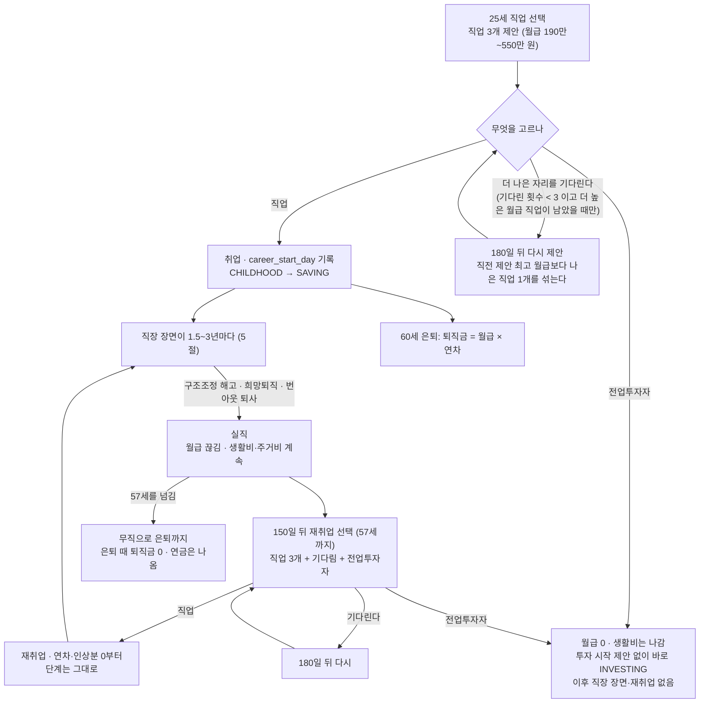

| 직업 | 기본 월급 | 연 인상 | 가중치 |
|---|---:|---:|---:|
| 편의점 알바 | 190만 | 1% | 7 |
| 농부 | 220만 | 2% | 6 |
| 공장 생산직 | 240만 | 2% | 7 |
| 공무원 | 250만 | 3% | 8 |
| 디자이너 | 270만 | 4% | 6 |
| 사무직 | 280만 | 3% | 10 |
| 교사 | 290만 | 3% | 6 |
| 영업직 | 300만 | 4% | 8 |
| 간호사 | 310만 | 4% | 5 |
| 개발자 | 350만 | 5% | 6 |
| 회계사 | 400만 | 5% | 3 |
| 대기업 사무직 | 420만 | 4% | 3 |
| 약사 | 450만 | 3% | 2 |
| 변호사 | 550만 | 5% | 1 |

월급 = 기본 월급 × (1 + 연 인상)^연차 × (1 + 협상·승진 인상분). 변호사가 제안에 나오면 더 높은 직업이 없으므로 "기다린다"가 붙지 않는다.

---

## 5. 직장 장면 축 — 연봉·승진·이직·구조조정·번아웃

직업이 있는 동안 1.5~3년마다 하나가 온다(57세까지, 직전 장면은 제외, 연차 조건 충족분 중 가중치). 판정이 있는 선택지는 `성공 확률 = 기본 + 능력치 × 점당`이다.

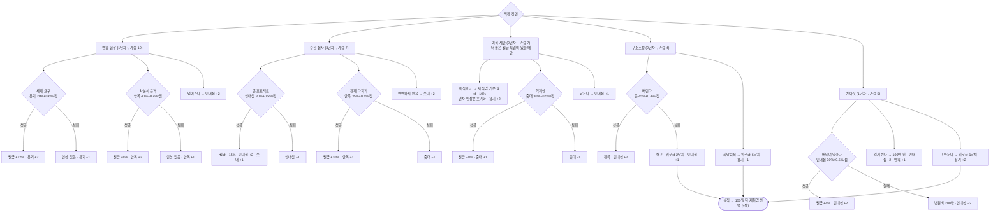

---

## 6. 투자 축 — 투자 시작, 뉴스, 흔들림, 빚투, 자유 매매

### 6.1 투자 시작 제안

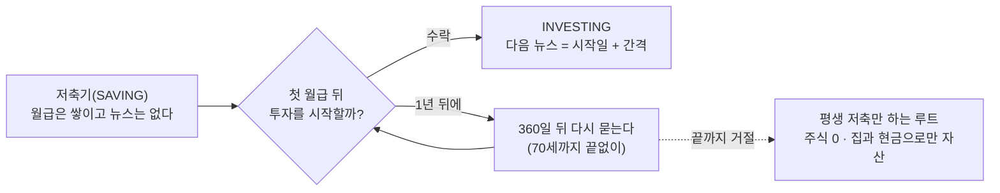

### 6.2 뉴스 선택 — 고른 행동이 능력치로 뒤집힌다

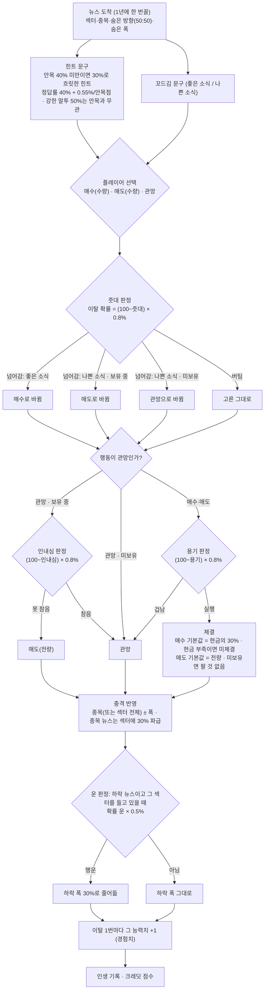

### 6.3 흔들림(인내심 시험)과 빚투

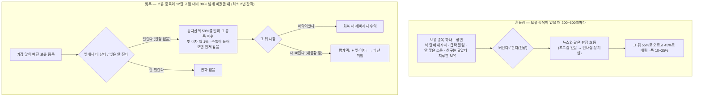

### 6.4 자유 매매

투자기에 대기 중인 선택이 없으면 언제든 종목(6섹터 18종목)을 수량으로 사고팔 수 있다. 꼬드김이 없으므로 **용기 판정만** 걸린다(겁나면 관망). 이탈은 능력치 경험치로 쌓이고 실현 손익은 크레딧의 "가장 잘한/아쉬운 선택" 후보가 된다.

---

## 7. 가족 축 — 결혼·자녀

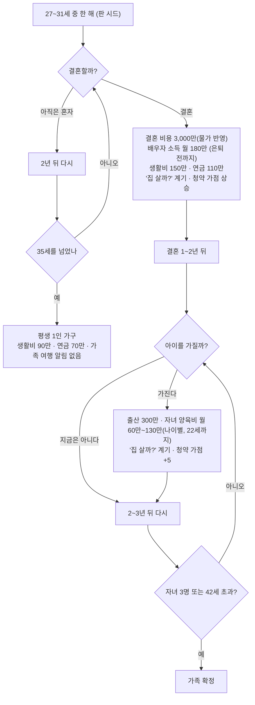

가족 형태는 결과적으로 **미혼 / 기혼 무자녀 / 자녀 1·2·3명**의 다섯 갈래다.

---

## 8. 주거 축 — 독립·전월세·전세사기·청약·내 집·갭투자

### 8.1 상태 흐름

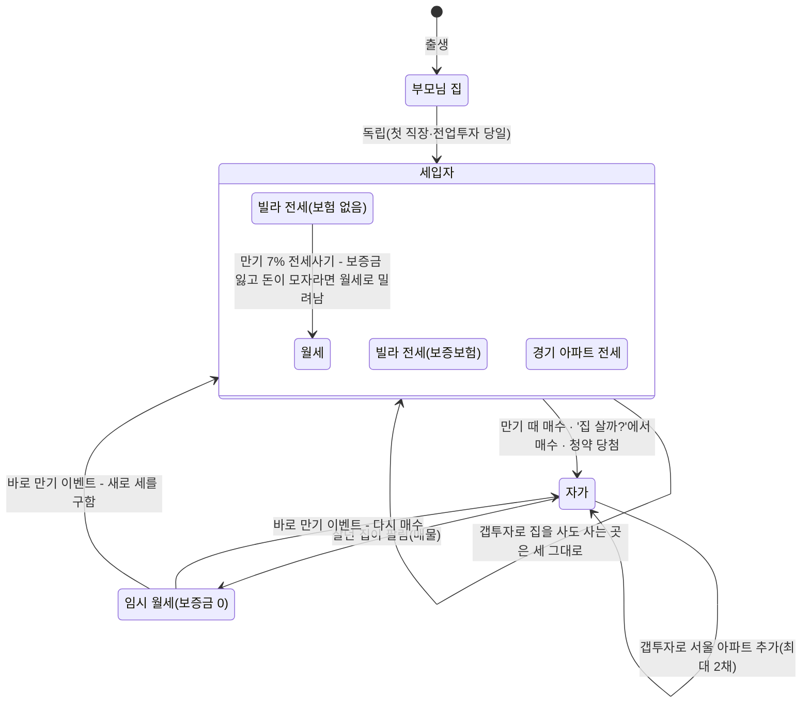

### 8.2 주거 이벤트와 선택지

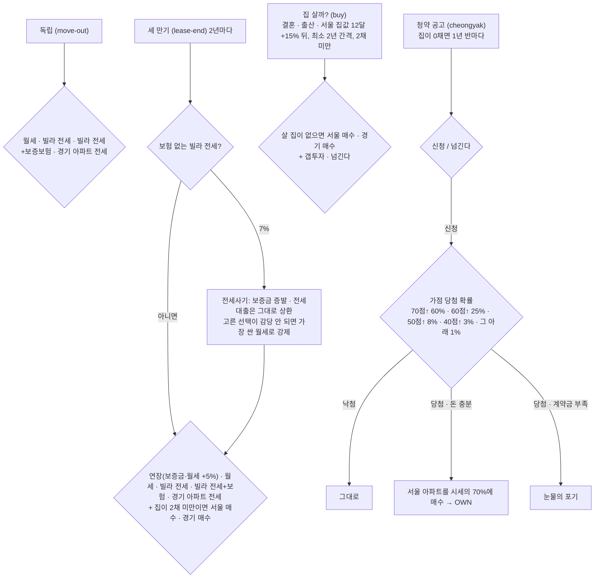

**감당 판정** (선택지마다 미리 계산해 막는다)

- 매수: 주담대 = min(시세 × LTV 50%, DSR 40% 한도). 나머지 현금(이사하며 돌려받는 보증금 포함)이 모자라면 막힘. **소득이 없으면 주담대 0** → 전업투자자·실직·은퇴 뒤에는 현금으로만 산다.
- 전세: 전세대출 80%(소득이 있을 때만). 아파트 전세 = 경기 시세 55%, 빌라 = 경기 시세 30%(1인)/40%(가족).
- 월세: 언제나 가능. 보증금이 모자라면 부족분 × 0.5%를 월세에 얹는다.
- 갭투자: 서울 시세 − 세입자 보증금(시세 55%)을 현금으로. 2채까지.
- 청약 가점 = 무주택 기간(30세·결혼 중 빠른 날부터 연 2점, 최대 32) + 부양가족(본인 5 + 배우자·자녀당 5, 최대 35) + 청약통장(독립부터 2 + 연 1점, 최대 17).

### 8.3 집을 가진 뒤의 매달

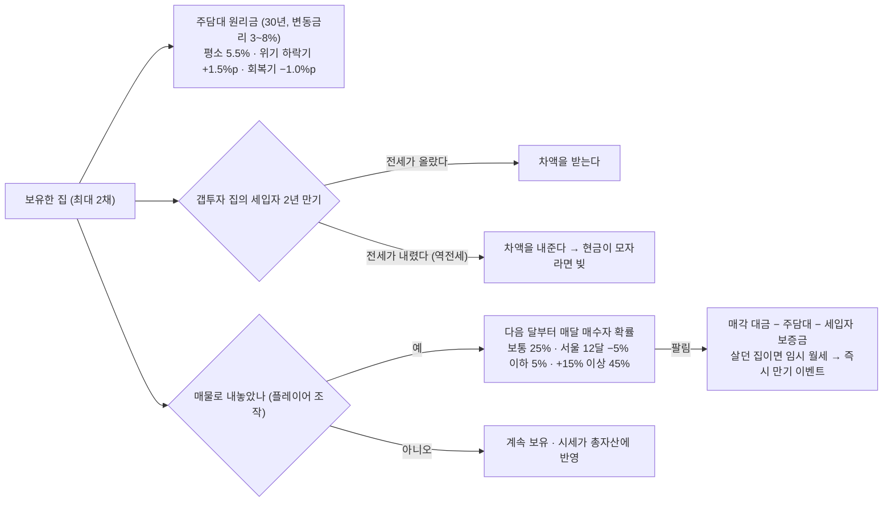

---

## 9. 생활 축 — 성인 일상 장면과 알림

### 9.1 성인 일상 장면 (8개 풀, 1.5~2.5년마다, 다 쓰면 끝)

성향은 바꾸지 않고 능력치·돈만 움직인다. **직장 배경 장면 7개는 직장에 다니는 동안에만** 나오고, 실직·은퇴·전업투자 중에는 풀에 남는다(재취업하면 다시 나온다). 직장과 무관한 장면은 "부모님 병원비 800만 원" 하나다.

| 장면 | 직장 필요 | 비고 |
|---|:---:|---|
| 성과급 300만 원 | ✓ | |
| 동료가 500만 원을 빌려 달라 | ✓ | 빌려주면 65%로 525만 원 회수 / 35%로 떼임. 일부만 빌려주기(−100만)도 있음 |
| 아침 뉴스 "증시 폭락" | ✓ | |
| 승진 vs 스카우트 | ✓ | |
| "지금 안 사면 못 산다" 집값 | ✓ | |
| 주말 부업 제안 | ✓ | |
| 퇴직연금 운용 방식 | ✓ | |
| 부모님 병원비 800만 원 | | 전업투자자·무직도 만남 |

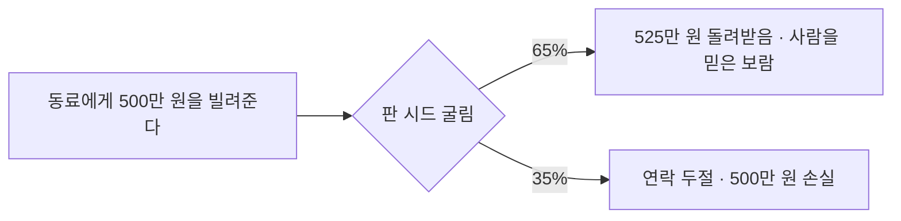

### 9.2 알림 (선택 없음, 240~600일마다, 조건에 맞는 것 중 가중치)

| 알림 | 금액 | 조건 |
|---|---:|---|
| 경조사비 | −30만 | |
| 병원비 | −150만 | |
| 자동차 수리 | −80만 | |
| 명절 귀성 | −60만 | |
| 부모님 칠순 | −200만 | |
| 자동차보험 갱신 | −90만 | |
| 경품 당첨 | +50만 | |
| 가족 여행 | −250만 또는 순자산 1% 중 큰 쪽 | 결혼 |
| 명절 보너스 | +월급 50% | 직장 |
| 연말정산 환급 | +월급 30% | 직장 |
| 방학 특강 | −120만 | 자녀 |
| 입학 준비 | −80만 | 자녀 |

---

## 10. 경기 축 — 전조·조정·불황·대공황

한 판에 불안한 시기(창)가 1~3번, 26~60세 사이에 온다. 모델은 리먼 사태(부동산 금융 위기), IT 버블(기술주 버블 붕괴), IMF(외환 위기), 1929년(세계 대공황)이며 갈래마다 섹터·부동산 타격 비율이 다르다.

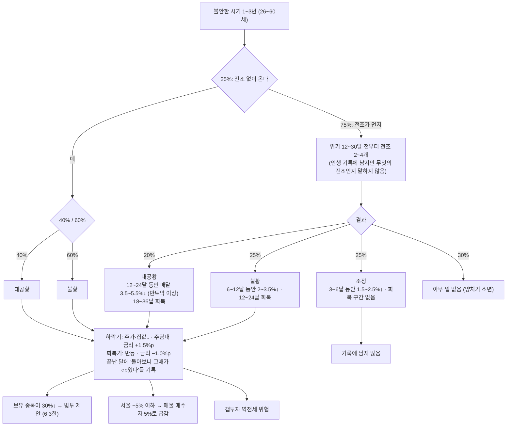

---

## 11. 매달 정산과 엔딩 — 정상 종료·파산

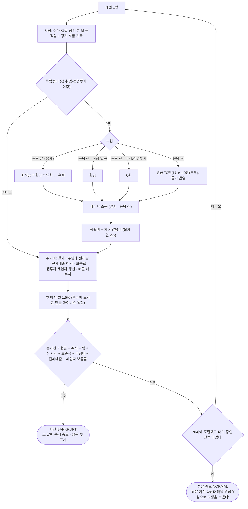

### 엔딩 크레딧 → 인생 기록부

```mermaid
flowchart LR
    E(["NORMAL / BANKRUPT"]) --> C1["제목: {별명}의 투자 인생"]
    C1 --> C2["타고난 것: 초기 능력치 등급 · 초기 자산"]
    C2 --> C3["성향: 투자자 유형 · 성장기 선택들"]
    C3 --> C4["일: 취직·기다림·직장 장면·은퇴"]
    C4 --> C5["가족: 결혼·자녀"]
    C5 --> C6["뉴스 앞에서: 선택 횟수 · 이탈 횟수"]
    C6 --> C7["살아온 집"]
    C7 --> C8["지나온 폭풍: 겪은 위기"]
    C8 --> C9["가장 잘한 선택 / 가장 아쉬운 선택"]
    C9 --> C10["산 주식들: 종목별 수익률"]
    C10 --> C11["마지막: 초기 → 최종 자산 · 연금 또는 파산 문장"]
    C11 --> LR["인생 기록부 → 다시 태어나기"]
```

별명은 출생 능력치로 정한다: 모두 60 이상이면 **타고난 투자 천재**, 모두 30 미만이면 **앞날이 험난한 사람**, 편차 10 미만이면 **무난한 보통 사람**, 그 밖에는 "{약점 수식어} {강점 칭호}"(예: 귀가 얇은 돌부처).

---

## 12. 대표 루트 시나리오

축을 엮은 대표 경로다. 각 루트는 실제로 나올 수 있는 분기만으로 이어진다.

### 루트 A — 성실한 직장인 장기투자자 (정석 엔딩)

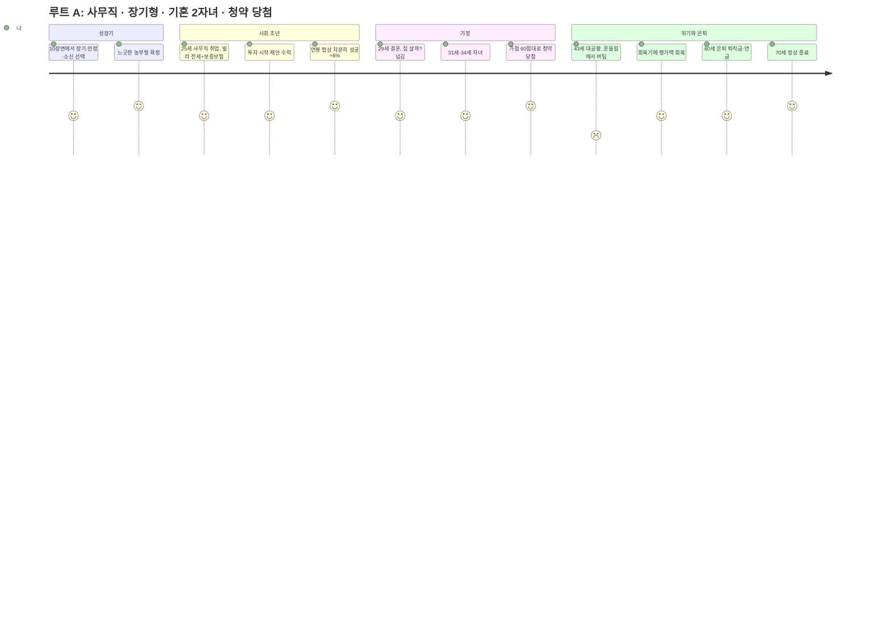

### 루트 B — 전업투자자

1. 25세 직업 선택에서 **전업투자자** → 같은 날 독립(월세), 투자 시작 제안 없이 바로 투자기.
2. 월급 0, 생활비·월세는 나감 → 자산은 초기 자산과 투자 수익이 전부.
3. 직장 장면·재취업·직장 배경 일상 장면·명절 보너스·연말정산 없음. 전세대출·주담대 불가(소득 0, 결혼하면 배우자 소득으로 가능).
4. 갈림길: 뉴스에서 잘 맞히면 큰 부 / 초기 자산이 작고 손실이 겹치면 **20대 파산**까지 가는, 가장 빠른 파산 루트.

### 루트 C — 세 번 기다린 사람

25세 제안(사무직·농부·공무원) → 기다림 → 25.5세 제안(더 나은 직업 1개 포함) → 기다림 → 26세 → 기다림 → 26.5세에는 "기다린다"가 사라지고 직업이나 전업투자자 중 하나를 골라야 한다. 기다리는 동안은 독립 전이라 생활비가 나가지 않는다.

### 루트 D — 구조조정 → 실직 → 재취업

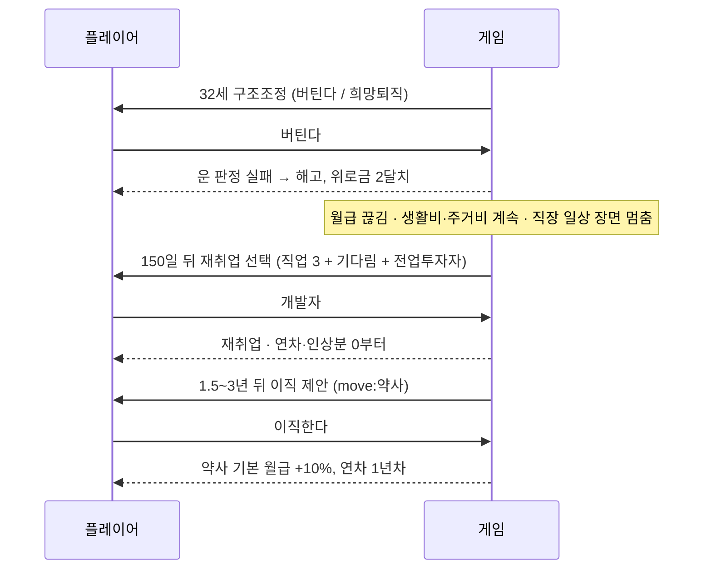

### 루트 E — 빚투 → 대공황 → 파산

1. 투자기, 관심 섹터(예: 반도체) 집중 보유.
2. 전조 3개("기술주가 이익의 100배", "택시 기사도 종목 이야기")를 무시.
3. 기술주 버블 붕괴(대공황): 반도체 섹터가 160% 비율로 빠짐 → 12달 고점 대비 30%↓ → **빚투 제안** → 빌린다(총자산의 50%).
4. 하락이 1년 넘게 이어짐 · 주담대 금리 +1.5%p · 빚 이자 월 1.5%.
5. 매달 정산 뒤 총자산 < 0 → **파산 엔딩**. 크레딧 "지나온 폭풍"에 위기가, "가장 아쉬운 선택"에 그때의 뉴스 선택이 남는다.

### 루트 F — 전세사기 피해자

독립 때 **보험 없는 빌라 전세**(보증료를 아낌) → 2년 만기마다 7% 사기 판정 → 걸리면 보증금 증발, 전세대출은 상환 → 고른 새 집이 감당 안 되면 가장 싼 월세로 밀려나고 부족분은 마이너스 통장. 연장(KEEP)을 골랐어도 새 월세방으로 옮긴다. 이후 보험 든 빌라나 아파트 전세로 바꾸면 위험이 사라진다.

### 루트 G — 갭투자 다주택자

결혼 뒤 "집 살까?"에서 경기 아파트 매수(실거주) → 2년 뒤 서울 집값 급등(+15%)으로 다시 "집 살까?" → **갭투자**로 서울 아파트 2번째 → 2채라 더 이상 매수·청약 제안 없음 → 경기 위기 때 전세가 하락으로 **역전세** 차액 지급, 매물로 내놓아도 매수자 확률 5% → 버티면 회복기에 이득, 현금이 마르면 빚 → 파산 위험.

### 루트 H — 평생 저축러

투자 시작 제안을 70세까지 계속 거절 → 뉴스·흔들림·빚투·자유 매매가 한 번도 없음. 자산은 월급 − 생활비와 집으로만 움직인다. 경기 위기는 집값과 금리로만 맞는다. 크레딧의 "뉴스 앞에서"·"산 주식들"이 비어 있다.

### 루트 I — 홀로 사는 무주택 투자자

결혼 제안을 35세까지 모두 거절 → 1인 생활비·1인 연금, 가족 여행 알림 없음, "집 살까?" 계기는 서울 집값 급등뿐 → 청약 가점이 낮아(부양가족 5점, 최고 54점) 당첨 확률 1~8% → 평생 전월세. 주거비는 적고 투자 원금은 크다.

---

## 13. 루트 조합표

한 판의 루트는 아래 축에서 하나씩 고른 조합이다(시간 순서에 따라 여러 번 바뀌는 축도 있다).

| 축 | 갈래 | 갈리는 지점 |
|---|---|---|
| 출생 | 능력치 등급 SSS~F × 5종 · 초기 자산 100만~5,000만 | 출생(무작위) |
| 성향 | 기간 2 × 위험 2 × 소신 2 = 유형 8종 · 관심 섹터 6 | 성장기 10장면 |
| 첫 직업 | 직장 14종 / 기다림(0~3번) / 전업투자자 | 25세 |
| 경력 | 장기근속 / 인상·승진 / 이직 / 해고·희망퇴직·퇴사 → 재취업·전업투자·무직 | 직장 장면 1.5~3년마다(57세까지) |
| 투자 시작 | 즉시 / N년 뒤 / 평생 안 함 | 투자 시작 제안 1년마다 |
| 뉴스 행동 | 매수·매도·관망 × 줏대·인내심·용기 이탈 × 운 완화 | 뉴스 1년마다 |
| 흔들림 | 버팀 / 매도 (인내심·용기 이탈) | 보유 중 300~600일마다 |
| 빚투 | 빌림 / 안 빌림 | 보유 종목 30%↓ |
| 가족 | 미혼 / 기혼 무자녀 / 자녀 1~3 | 27~35세 결혼 · ~42세 자녀 |
| 주거 | 월세 · 빌라 전세(±보험) · 아파트 전세 · 자가(서울/경기/청약) · 갭투자 · 전세사기 | 독립 · 만기 2년 · 청약 1.5년 · 집 사기 2년 |
| 경기 | 위기 창 1~3개 × (대공황 · 불황 · 조정 · 아무 일 없음 · 무전조 위기) | 26~60세 |
| 생활 | 성인 일상 장면 8개 · 알림 12종 | 1.5~2.5년 / 8달~1년 8달마다 |
| 엔딩 | 정상 종료(70세) / 파산(파산한 나이) | 매달 정산 |
